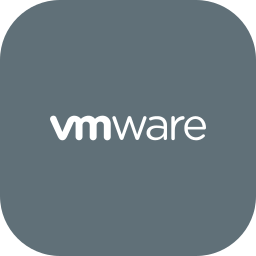
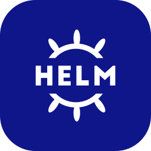
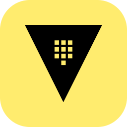

 

## About me

I've spent **more than 5 years** running **Linux, Kubernetes and network infrastructure** at **fintech and telecom** companies: most recently as a **Site Reliability Engineer at WSD**, a London-based fintech company, and before that as a **Senior Platform Engineer at bKash**, **Bangladesh's largest mobile financial services provider**.

Most of that work was on platforms that **move people's money** and answer to **PCI-DSS and ISO 27001** auditors. So I care about **tested failover**, changes with a **rollback plan**, and a **runbook written after every fix**.

| **1,000+** | **85M** | **99.99%** | **500+** | **600+** | **50 h/month** |
|:---:|:---:|:---:|:---:|:---:|:---:|
| servers administered | customers served | availability SLO | containerized apps on Kubernetes | TLS proxy endpoints on F5 BIG-IP | saved with Bash and Python automation |

## Right now

- **Studying:** **MSc in Communications Engineering** at **[Aalto University](https://www.aalto.fi/en)**, Espoo, graduating in **2028**. This term I'm taking **Cloud Software and Systems** and **Cybersecurity**, I've finished **Machine Learning**, and I'm planning a minor in **Quantum Technology**.
- **Aiming for:** putting **5 years of running production systems** together with what I'm learning about **cloud, security and quantum technology**, so I can design infrastructure that is **secure and reliable from the start**. I'm also publishing the automation I've used at work as **open code**, starting with **[ansible-linux-baseline](https://github.com/tanzilchy/ansible-linux-baseline)**.
- **Looking for:** **SRE, platform, DevOps, infrastructure or network engineering** work in **Finland** that I can do alongside my studies. I can **start right away**.

## 🧰 Toolchain

#### ☁️ Cloud and Infrastructure

  
  
  
  
  
  

#### 🐧 Linux and OS

  
  
  
  
  

#### 🐳 Containers and Orchestration

  
  
  
  

#### 🔁 CI/CD and Version Control

  
  
  
  

#### 🔐 Networking and Security

  
  
  
  
  
  

#### 📊 Observability and Monitoring

  
  
  
  

#### 🗄️ Data

  
  

#### 💻 Scripting

  
  
  

